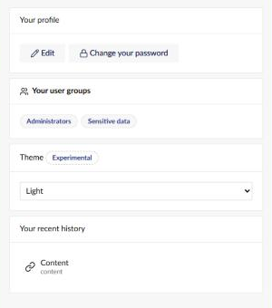
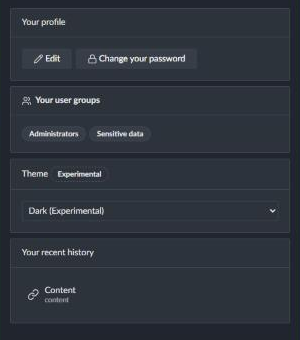

# Who Am I

[](https://www.nuget.org/packages/Umbraco.Community.WhoAmI/)
[](https://www.nuget.org/packages/Umbraco.Community.WhoAmI)
[](../LICENSE)

Shows which **user groups** the signed-in backoffice user belongs to, right in the current-user (avatar) panel.

Editors often ask "why can't I do X?" and nobody can tell at a glance which groups they are in. Who Am I answers that with one badge per group, using the Umbraco UI Library, so it follows your theme (light, dark, high contrast) automatically.




- Zero configuration: install and it appears.
- Shows the first three groups; a `+N` pill expands the rest, and `less` collapses them again.
- Each group links to its user group page, for users who have access to the Users section. Everyone else sees plain badges.
- Works with custom user groups as well as the built-in ones.
- Nothing is rendered when the user has no groups.
- Group names are rendered as text, never as HTML.
- No C# backend, no extra API endpoints.

## Installation

Add the package to an existing Umbraco website (v17+) from nuget:

`dotnet add package Umbraco.Community.WhoAmI`

Open the avatar menu in the top right of the backoffice. Your groups appear as a "Your user groups" box.

Requires Umbraco 17.0.0 or later.

## Customizing text and styling

**Text.** Strings use the Umbraco localization system and follow each user's backoffice language. English ships by default; other languages fall back to English. Current keys:

| Key | Default (en) |
|---|---|
| `whoAmI_heading` | Your user groups |
| `whoAmI_showMore` | +{0} |
| `whoAmI_showLess` | less |
| `whoAmI_showMoreLabel` | Show {0} more groups (screen reader label) |
| `whoAmI_showLessLabel` | Show fewer groups (screen reader label) |

To change or translate a string, register your own `localization` extension in your site, e.g. `App_Plugins/MySite/umbraco-package.json`:

```json
{
  "name": "My Site",
  "extensions": [
    {
      "type": "localization",
      "alias": "MySite.Localization.En",
      "name": "My Site English",
      "meta": { "culture": "en" },
      "js": "/App_Plugins/MySite/en.js"
    }
  ]
}
```

```js
// App_Plugins/MySite/en.js
export default {
  whoAmI: {
    heading: 'Your roles',
  },
};
```

**Styling.** The box and badges use Umbraco UI Library components and `--uui-*` tokens, so they follow the backoffice theme (light, dark, high contrast) out of the box.

To change the badge colours, set any of these CSS custom properties on `:root`. All are optional, and anything you leave unset keeps the theme default:

| Property | What it changes |
|---|---|
| `--who-am-i-tag-color` | Badge text colour |
| `--who-am-i-tag-background` | Badge background |
| `--who-am-i-tag-border-color` | Badge border (also the `+N` / `less` pill outline) |

The properties are read from inside the backoffice, so they need to be defined by CSS that runs there. The simplest way is a small bundle in your site. Create `App_Plugins/MySite/umbraco-package.json`:

```json
{
  "name": "My Site",
  "extensions": [
    {
      "type": "bundle",
      "alias": "MySite.Bundle",
      "name": "My Site Bundle",
      "js": "/App_Plugins/MySite/my-site.js"
    }
  ]
}
```

and `App_Plugins/MySite/my-site.js`:

```js
const style = document.createElement('style');
style.textContent = ':root { --who-am-i-tag-color: #7a1f3d; --who-am-i-tag-background: #fbe9ef; }';
document.head.append(style);

export const manifests = [];
```

Colors you set apply in every backoffice theme, so pick values that read well in both light and dark mode, or leave the properties unset to keep the theme colors.

Group names themselves come from Umbraco user groups and are not translated by this package.

## Contributing

Contributions to this package are most welcome! Please read the [Contributing Guidelines](CONTRIBUTING.md).

## Acknowledgments

Scaffolded with the [Opinionated Package Starter](https://github.com/LottePitcher/opinionated-package-starter) by Lotte Pitcher.
