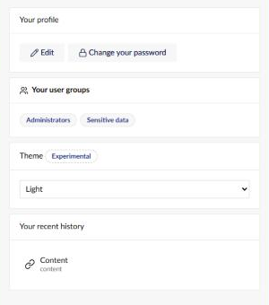

# Who Am I

Shows which **user groups** the signed-in backoffice user belongs to, in the current-user (avatar) panel. One badge per group, built with the Umbraco UI Library so it follows your theme and each user's backoffice language.

Requires Umbraco 17.0.0 or later. Install, open the avatar menu, done. No configuration needed.

Shows the first three groups with a `+N` pill to expand the rest. For users with access to the Users section, each group links to its user group page.

To change the text, register your own `localization` extension for the `whoAmI_*` keys. To change the badge colours, set the optional `--who-am-i-tag-color`, `--who-am-i-tag-background` and `--who-am-i-tag-border-color` CSS properties. See the [GitHub README](https://github.com/bilalmehrban/Umbraco.Community.WhoAmI#customizing-text-and-styling) for examples.
